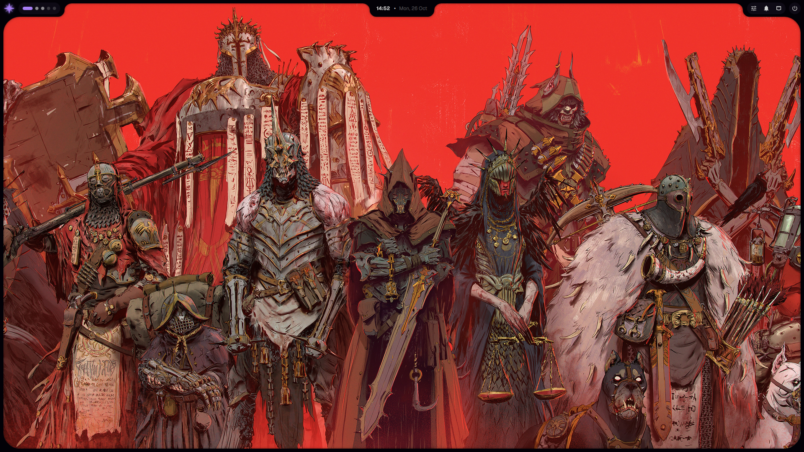
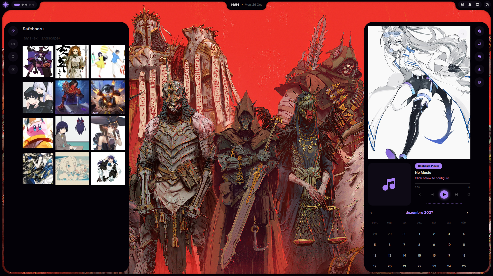

# TheBless0nxd 👋

**Linux, tiling desktops and personal configuration.**
I like to make the system my own: Arch, Hyprland, Quickshell and a lot of shell scripts.

---

## 🖥️ What I'm into

- **Arch Linux** with **Hyprland** (Wayland, tiling)
- **Quickshell** for the bar, panels and widgets
- Scripts in **Bash** and **Python**
- Dotfiles, color themes and automations

## 🎨 My rice

The **[rice](https://github.com/BlessedOn3/rice)** repository has my current setup: side panels (music, calendar, notifications, waifu card, Booru, GitHub and chat), per-workspace wallpapers, color palette switching and keyboard shortcuts.

## ✍️ Blog

Read my posts at **[blessedon3.github.io](https://blessedon3.github.io/)**.

## 📸 Screenshots

## 📫 Contact

tem naum
